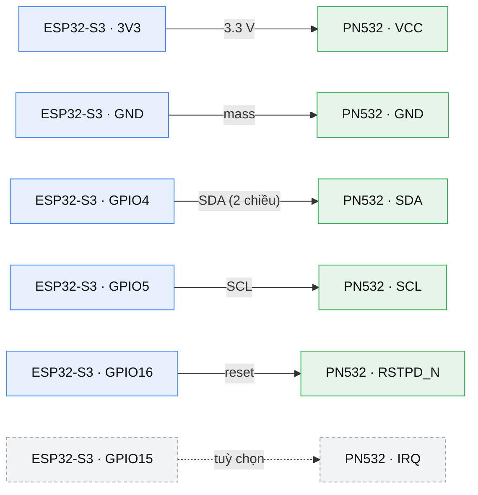

# PN532 (I2C) ↔ ESP32-S3-N16R8 — sơ đồ đấu dây

Chân I2C lấy từ [`include/board_pins.h`](../include/board_pins.h)
(`PIN_PN532_SDA = GPIO4`, `PIN_PN532_SCL = GPIO5`).
Module: PN532 breakout (Elechouse V3 hoặc clone tương đương), chế độ **I2C**.
Địa chỉ I2C 7-bit: `0x24` — xác nhận từ `PN532_I2C_ADDRESS (0x48 >> 1)` trong
[`Adafruit_PN532.h`](../.pio/libdeps/attak-iot-firmware/Adafruit%20PN532/Adafruit_PN532.h).

## 1. Công tắc chọn chế độ trên module PN532

| Chế độ | SEL0 | SEL1 |
| --- | --- | --- |
| **I2C (dùng trong dự án)** | **ON** | **OFF** |
| SPI | OFF | ON |
| HSU/UART | OFF | OFF |

## 2. Sơ đồ đấu dây

Xanh dương = phía ESP32-S3, xanh lá = phía module PN532, xám nét đứt = chân tuỳ chọn.
Bốn chân `SCK` / `MISO` / `MOSI` / `SS` của module để trống hoàn toàn ở chế độ I2C.

## 3. Bảng dây

| # | ESP32-S3 | Module PN532 | Bắt buộc | Ghi chú |
| --- | --- | --- | --- | --- |
| 1 | 3V3 | VCC | có | Cấp 3.3 V để mức logic khớp ESP32-S3 (GPIO không chịu 5 V) |
| 2 | GND | GND | có | |
| 3 | GPIO4 | SDA | có | `PIN_PN532_SDA` |
| 4 | GPIO5 | SCL | có | `PIN_PN532_SCL` |
| 5 | GPIO16 | RSTPD_N | khuyến nghị | Nhận `_reset` của constructor; `begin()` gọi `reset()` để đưa chip về trạng thái xác định |
| 6 | GPIO15 | IRQ | tuỳ chọn | Nhận `_irq` của constructor; **không** cần cho giao tiếp I2C (xem mục 4) |

GPIO15 / GPIO16 không trùng chân nào đang dùng (4–14, 48) và không nằm trong nhóm
bị loại trừ ở [`research/01-pin-mapping-findings.md`](planning/research/01-pin-mapping-findings.md)
(0/3/45/46 strap, 19/20 USB, 43/44 UART, 33–37 PSRAM octal).

## 4. Vì sao RESET khuyến nghị còn IRQ thì không

Đọc source `Adafruit_PN532`:

- `Adafruit_PN532(uint8_t irq, uint8_t reset, TwoWire *theWire)` — cả hai tham số
  **bắt buộc**, và constructor gọi `pinMode(_irq, INPUT)`, `pinMode(_reset, OUTPUT)`.
  Không có overload I2C nào bỏ được chúng, nên vẫn phải truyền số GPIO hợp lệ.
- `isready()` khi ở chế độ I2C đọc byte RDY qua chính bus I2C:
  `i2c_dev->read(rdy, 1); return rdy[0] == PN532_I2C_READY;`
  Nhánh dùng `digitalRead(_irq)` chỉ chạy khi **không** có SPI/I2C/serial device,
  tức không bao giờ xảy ra với constructor I2C. → **IRQ không cần cho
  `getFirmwareVersion()` hay bất kỳ lệnh nào.**
- `begin()` gọi `reset()`; `reset()` chỉ tác động khi `_reset != -1`, kéo RSTPD_N
  LOW 1 ms rồi HIGH. Nối chân này cho lần bring-up sạch, tránh chip kẹt trạng thái
  sau lần cấp nguồn trước.

## 5. Lưu ý phần cứng

- Module Elechouse V3 đã có pull-up I2C trên board. Nếu module của bạn không có,
  thêm 2× 4.7 kΩ từ SDA và SCL lên 3V3.
- `begin()` gọi `i2c_dev->begin(false)` — bỏ qua kiểm tra address, vì PN532 ngủ
  sau khi cấp nguồn. Đừng dùng một I2C scanner làm tiêu chuẩn "module sống";
  tiêu chuẩn đúng là `getFirmwareVersion()` trả về khác 0.
- Constructor của `Adafruit_PN532` chạy `pinMode()` ngay tại thời điểm khởi tạo.
  Nếu khai báo object toàn cục, việc này xảy ra trước `setup()` — nên khởi tạo
  trong `pn532::begin()` thay vì global.

## 6. Trạng thái implement (ticket 07)

Đã nối trong [`pn532_module.cpp`](../src/modules/pn532_module.cpp):

1. `PIN_PN532_IRQ = GPIO15`, `PIN_PN532_RST = GPIO16` trong
   [`board_pins.h`](../include/board_pins.h).
2. `begin()` gọi `Wire.begin(PIN_PN532_SDA, PIN_PN532_SCL)`, tạo `Adafruit_PN532`
   bằng `new` + `std::unique_ptr::reset` (toolchain build `gnu++11`, không có
   `std::make_unique`; vẫn không phải object global — xem §5) rồi `nfc->begin()`
   (reset + SAMConfig wakeup).
3. `poll()` probe mỗi 1 s khi đang kết nối, 2 s khi mất kết nối;
   `connected = getFirmwareVersion() != 0`. Probe fail chạy lại `begin()` để module
   cắm sau khi boot vẫn được reset/wakeup.
4. `detail` = `PN532 v<ver>.<rev> (IC 0x.., support 0x..)` khi sống; khi chết là
   chuỗi lỗi I2C `0x24` kèm checklist dây nguồn/SDA/SCL/SEL.

Chưa xác minh trên board thật; bring-up vẫn cần chạy mục 5 ở trên.
